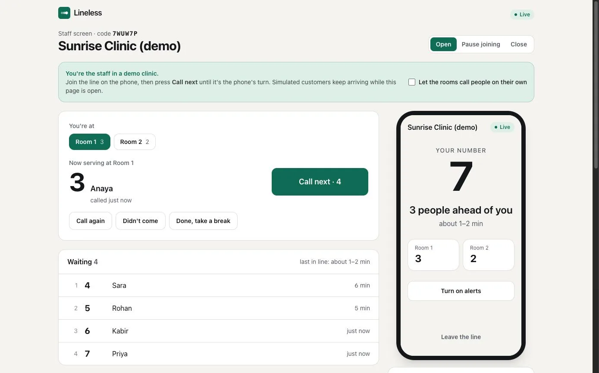
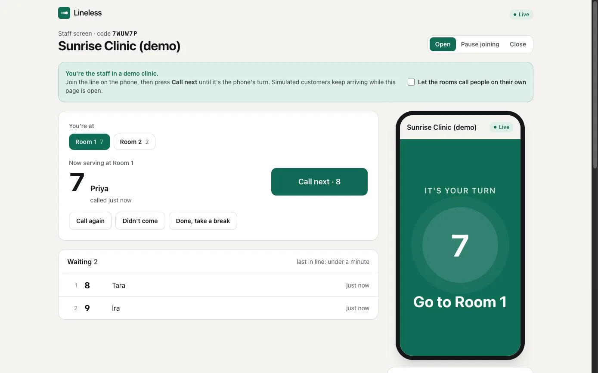
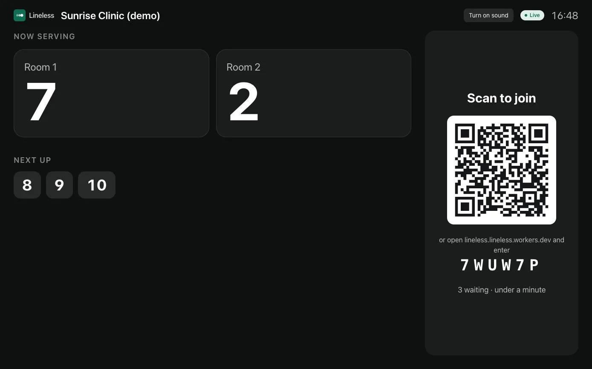
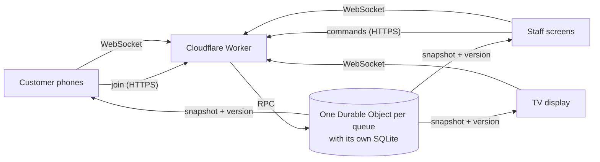

# Lineless

**A walk-in line that lives on people's phones.** They scan a QR code, see their place and how
long it'll be, and get called when it's their turn. No app, no sign-up, nobody shouting names
across a crowded room.

**Live demo: [lineless.lineless.workers.dev](https://lineless.lineless.workers.dev)**. Press
"Try the live demo", join the line on the phone next to the staff screen, then press "Call next"
until it's the phone's turn. Or scan the QR code with your own phone.



## The problem

Clinics, salons, government offices and placement cells run on paper tokens and a raised voice.
People stand in a crowded room for an hour because leaving means missing their turn, and nobody
can tell them how long it'll be. Apps that fix this want everyone to install something.

Lineless needs a QR code at the door and a phone or laptop at the desk:

- **Customers** scan, optionally type a name, and get a number. Their phone shows their place,
  an estimated wait that learns from how fast the line really moves, and what each counter is
  serving. When it's their turn: a chime, a vibration and a full-screen "Go to Room 2".
- **Staff** press "Call next" at their counter. They can call someone again, mark them as not
  having come, bring them back to the front, pause new joins, and close for the day.
- **A TV in the waiting room** shows who's being served where, who's next, and the QR code.

| | |
| --- | --- |
|  |  |

## How it works



Each queue is one Cloudflare **Durable Object**, a single-threaded object with its own SQLite
database. Every command for that queue runs inside it. The state transition reads, applies and
persists without an `await` in between, so two commands can never interleave: two staff pressing
"Call next" at the same moment are handled one after the other, by construction.

Commands go over HTTP; state comes back over WebSockets as full snapshots with a version, so a
phone that drops off and reconnects needs no catch-up: the first message is the truth.

The details are in [docs/architecture.md](docs/architecture.md), the reasoning in
[docs/decisions.md](docs/decisions.md), and the endpoints in [docs/api.md](docs/api.md).

## The parts worth a closer look

**Two different bugs that look like one.** A retried "Call next" whose answer was lost would call
the *next* person, skipping someone. So every command carries a request id, and a repeat gets the
first answer. A double click is a different bug: two distinct, legitimate requests. So "Call
next" also carries the ticket the screen shows at that counter, and is refused if the counter
has already moved on. Both are tested.

**A wait estimate measured against reality, not eyeballed.** The estimate learns service time
from the queue, drops samples where idle time would masquerade as service, accounts for free
counters and services already under way, and shows a range sized from the measured spread. A
simulation replays 200 unkind days per scenario through the real domain code:

| Scenario | Host's guess only | Lineless | Real wait inside the range shown |
| --- | --- | --- | --- |
| Clinic, guess too high | 6.5 min median error | **2.2 min** | 85% |
| Service desk, guess too low | 4.0 min | **1.7 min** | 87% |
| Interview day, guess right | 3.9 min | 4.1 min | 89% |

The first version of the estimate was a few minutes pessimistic for everyone; the simulation
showed why, and the fix is in [docs/results.md](docs/results.md).

**Live updates under load.** 1,000 phones on one queue in production, 20 presses of "Call next":
all 20,000 updates delivered, **160 ms** median and **231 ms** at the 99th percentile from the
press to a phone, measured from Bangalore, network included.

**Built to be left alone.**
- Idle queues cost nothing: sockets hibernate, and keep-alives are answered without waking the queue.
- Demo queues expire after a day and idle queues after 30 days.
- Finished tickets, and the names on them, are deleted after 7 days.
- Names never reach anyone but staff.

## Run it

```bash
npm install
npm run dev        # app and API on http://localhost:5173, Durable Objects running locally
npm test           # 40 tests inside the Workers runtime, with real Durable Objects and SQLite
npm run check      # types, tests, build
npm run simulate   # the wait-estimate simulation
npm run loadtest -- --url http://localhost:5173 --sockets 500 --calls 20
```

Deploying needs a Cloudflare account (the free plan is enough) and `npx wrangler login`;
`npm run deploy` runs every check first.

## Layout

```
src/domain/    the queue: state machine, views, wait estimator (no runtime dependencies)
src/shared/    the wire protocol and the wait range, used by both sides
src/worker/    the Worker, the queue's Durable Object, storage, rate limits, the demo
src/app/       the React app: home, customer, staff and display pages
test/          domain and end-to-end tests
scripts/       the wait simulation and the load test
docs/          architecture, decisions, API, results
```

## What it doesn't do (yet)

- **Alerts with the browser closed.** It chimes, vibrates, notifies in the background and keeps
  the screen awake, but a killed tab gets nothing. Web Push is next.
- **Appointments mixed with walk-ins**, or very different service lengths in one line.
- **Rotating a leaked staff link** without starting a new line.
- **One location per queue.** Each queue lives in one Cloudflare location, chosen when it's
  created, so screens far from it see slower updates.

Built by [Paras Dev Tyagi](https://pdt001.vercel.app).
