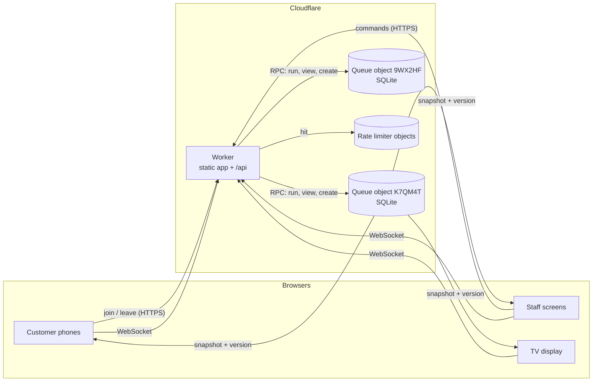

# Architecture

## The pieces

- **The Worker** serves the web app as static files and handles `/api/*`. It validates every
  request (zod schemas, an 8 KB body cap, the code's format), applies the creation rate limits,
  and passes the request to the right queue's object. It holds no state.
- **A queue object** (`src/worker/queue-object.ts`) is a Durable Object named by the queue's
  code. It owns the queue: configuration, tickets, remembered command answers and an event log,
  all in its own SQLite database. Every command for the queue runs here.
- **Rate limiter objects** count creations per client address hash in fixed one-hour windows and
  delete themselves when the window ends.
- **The domain** (`src/domain/`) is plain TypeScript with no runtime dependencies: the state
  machine (`apply`), the views each audience sees, and the wait estimator. The queue object,
  the tests and the simulation all run the same code.

## A command, end to end

"Call next" at Room 2:

1. The staff screen sends `POST /api/q/K7QM4T/commands` with a new request id, the command and
   `expectServing` (the ticket it shows at Room 2), with the staff key as a bearer token.
2. The Worker validates the body and calls `queue.run(...)` on the object for `K7QM4T`.
3. The object hashes the command, the staff key and any device id. These are the only `await`s,
   and they happen before it reads any state.
4. Synchronously, with no `await` from here to the end of step 6:
   - read the in-memory state (loaded from SQLite on first use after a wake-up);
   - return the stored answer if this request id was seen;
   - check the staff key against its stored hash;
   - `apply` the command, a pure function that returns the next state, the tickets that changed and
     events, or a domain error such as `counter_changed`.
5. Write the new configuration, the changed tickets, the events and the request id's answer in
   one SQLite transaction (`transactionSync`).
6. Swap in the new state and broadcast it.
7. Answer the request. The runtime holds the response until the write is durable.

Because the object handles one event at a time and nothing in steps 4–6 yields, no other command
can observe or change the queue halfway through. That's the whole concurrency story: no locks, no
optimistic retries inside the server.

## Live updates

Screens connect to `/api/q/:code/ws`. The object accepts the socket with the **hibernation
API**: while nothing happens, the object can be evicted from memory and the sockets stay open,
so an idle queue with a hundred phones connected costs nothing. Keep-alive pings are answered by
the runtime (`setWebSocketAutoResponse`) without waking the object.

Each socket carries a small attachment with its role:

| Role | How | Receives |
| --- | --- | --- |
| public | default | queue view: counters, waiting numbers, pace |
| staff | `hello` with the staff key | + full lists with names, session totals |
| customer | `hello` with ticket id + device id | + their own ticket and position |

A broadcast serialises the public view once and the staff view once, then builds each customer's
message by adding their small `you` object, so it costs one JSON encoding per audience, not per
socket. The first change after a quiet period goes out immediately; further changes within 50 ms
coalesce.

On the client (`src/app/lib/socket.ts`):
- the hook keeps the newest version it has seen;
- it pings every 20 seconds, and treats a socket that has heard nothing for 50 seconds as dead,
  because a half-open connection never fires `close`;
- it reconnects with jittered backoff capped at 10 seconds, and straight away when the page becomes
  visible again or the network returns.

There's nothing to replay after a reconnect: the first message is the current state.

## Storage

One SQLite database per queue:

| Table | Holds | Kept |
| --- | --- | --- |
| `queue` | One row: configuration, counters, session totals, estimator state, version | While the queue exists |
| `tickets` | One row per ticket | Finished tickets: 7 days |
| `requests` | Request id → fingerprint and answer | 1 day |
| `events` | Append-only log: joined, called, served, missed… | 30 days |

The object keeps a working set in memory: the configuration plus tickets that are waiting,
called, or finished in the last two hours. That's enough for "bring back" and for a customer's
"you're done" screen. Reading a code that has no queue never creates tables, so random codes
cost nothing.

## Alarms

Each queue has one alarm, set to the earliest of:
- **Expiry.** 30 days after the last activity, or 1 day after creation for a demo. The queue tells
  every socket it's gone and deletes all its storage.
- **Housekeeping.** Every 6 hours: prune old requests, tickets and events.
- **Demo ticks.** Every 3–6 seconds, only while a demo has a socket open: simulated arrivals, and
  auto-serve if it's on.

## Security and privacy

| Concern | Handling |
| --- | --- |
| Staff actions | 256-bit random key; only its SHA-256 is stored, compared in constant time; carried in the URL fragment so it never reaches a server log |
| Customer actions | Random device id per browser; the ticket stores its hash; leaving or watching a ticket needs it |
| Names | Optional, staff-only; never in the public view (tested) |
| Data retention | Finished tickets deleted after 7 days; idle queues after 30 |
| Abuse | Creation limits per address; join limits per address per queue; caps on line length and screens; 8 KB bodies |
| Browser | Content-Security-Policy `default-src 'self'`, no third-party scripts, `frame-ancestors 'self'` |

## Limits I know about

- **No alerts with the browser closed.** The page chimes, vibrates, shows a notification when in
  the background, and keeps the screen awake, but a phone that has killed the tab gets nothing.
  Web Push would fix it on Android; on iPhones it needs the site installed to the home screen.
- **One location per queue.** A queue's object lives near where it was created. A queue made in
  India and watched from Europe pays the distance on every update.
- **Staff keys can't be rotated** without starting a new queue.
- **One kind of service per queue.** The estimate assumes everyone takes about the same time and
  is served in order; appointments mixed with walk-ins would need more.
- **The join limit lives in memory**, so it resets if the object is evicted. It slows abuse; it
  doesn't account for it.
